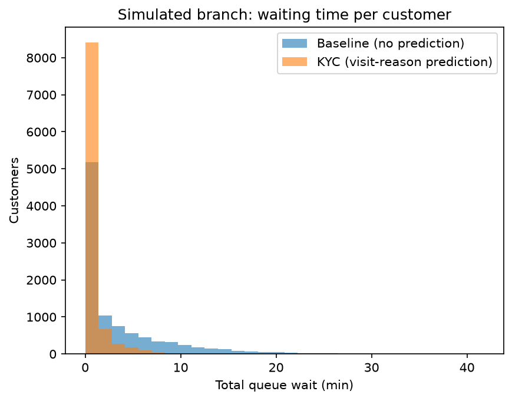

# Know Your Customer

Predicts **why a bank customer is visiting the branch** from their last mobile-banking events, so the right desk and form are ready before they reach the counter. Built as a computer engineering capstone project (CENG 495).



## Results

| | Value |
|---|---|
| Visit-reason prediction (GRU, synthetic data) | **Top-3 accuracy 0.92** |
| Face recognition at threshold 0.68 (DeepFace test set, 299 labelled pairs) | FAR 0.0 · FRR 0.0 |
| Branch simulation: average wait | 3.41 → 0.55 min (−84%) |
| Branch simulation: P90 wait | 10.26 → 2.00 min (−81%) |
| Branch simulation: daily redirects | 79.6 → 35.8 (−55%) |

## How it works

1. **Synthetic data**: `generate_data.py` creates customers with sequences of mobile events (OTP failures, password resets, ATM failures, chargebacks…) whose order carries the visit reason.
2. **Models**: LightGBM baseline vs. a GRU sequence model (`baseline_lgbm.py`, `neural.py`, `train.py`).
3. **Identification**: opt-in face recognition (ArcFace embeddings via DeepFace) with consent withdrawal, or customer number fallback (`face.py`, `face_eval.py`).
4. **Branch simulation**: discrete-event simulation with SimPy comparing today's process and KYC (`simulate.py`).
5. **Demo**: 5-tab Streamlit app (branch entry, agent screen with local LLM summary via Ollama, opt-in registration, simulation, model results) (`app.py`).

## Run

```bash
python3 -m venv .venv && .venv/bin/pip install -r requirements.txt
PYTHONPATH=src .venv/bin/python src/generate_data.py
PYTHONPATH=src .venv/bin/python src/train.py
PYTHONPATH=src .venv/bin/streamlit run src/app.py
```

`data/synthetic.csv` and `data/model.pt` are included, so the first two steps are optional. The face evaluation uses DeepFace's public test set (`tests/unit/dataset`), downloaded into `data/yuz_test/`. The agent summary needs [Ollama](https://ollama.com) with `qwen3:8b`.

> UI labels and code comments are in Turkish; all data is synthetic.

## Stack
Python · PyTorch · LightGBM · scikit-learn · DeepFace · SimPy · Streamlit · SQLite · Ollama
